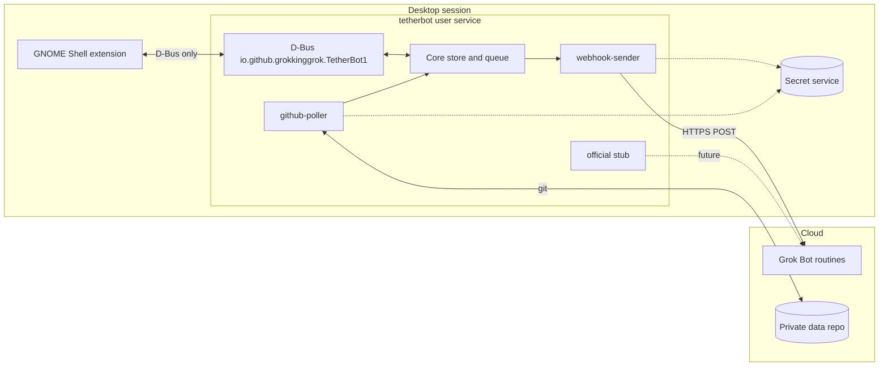

# TetherBot

**Keep your GNOME desktop connected to your Grok bots.**

TetherBot is an unofficial local bridge that puts your Grok bots in the GNOME top bar. See status, get notifications, and send quick actions from the desktop—without leaving your session or pasting secrets into chat.

It is **pre-alpha**. The core pieces work, but expect rough edges.

**Unofficial, not affiliated with xAI.**

## What you get

### Without a feed repo (webhook only)

You can:
- Keep a local clipboard history (pin, tag, edit, search the web)
- Run a work timer
- Send clipboard text to a bot as a todo, todo-with-context, or “tell me more” (the bot receives it; the resulting item does not appear back on the desktop)
- Send actions on any items that already exist

You do **not** get bots, asks, or todos in the top-bar popup, and the timer cannot be attached to todos.

### With a private feed repo

You get everything above, plus:
- Bots, asks, and todos appear in the top bar and popup
- The bot can write status and items that the desktop shows
- Work timer can be assigned to specific todos
- Desktop state is written back so the bot can see what you did

The feed repo is optional only if you are fine with the limited set. The full experience requires it.

## Quick start

The shortest path that gives you the full tool is the one with a private feed repo.

1. You need GNOME Shell 50 on Wayland (Fedora 44 is the reference) and Python 3.13+.
2. Clone this repo and run `scripts/install.sh`.
3. Follow [docs/SETUP.md](docs/SETUP.md).  
   - For the limited (webhook-only) set: stop after the webhook secret is stored and the adapter is enabled.  
   - For the full set: also create a private repo from `template-repo/` and enable the github-poller.
4. Log out and back in, then enable the extension (`tetherbot@grokkinggrok.github.io`).

Copy-paste prompts for the bot and for a coding agent are in [docs/prompts/](docs/prompts/).

## Architecture



Desktop → bot uses a documented routine webhook (authenticated HTTP POST). Bot → desktop has no official path today, so the working approach is the bot writing to a private git repository the bridge polls. Both stay off until you enable them.

## Documentation

| Path | What it is |
|---|---|
| [docs/SETUP.md](docs/SETUP.md) | Human setup checklist |
| [docs/MANUAL-CHECKS.md](docs/MANUAL-CHECKS.md) | Desktop verification steps |
| [docs/SPEC.md](docs/SPEC.md) | Architecture source of truth |
| [docs/PROTOCOL.md](docs/PROTOCOL.md) | Item model and action envelope |
| [docs/ROADMAP.md](docs/ROADMAP.md) | v0.1 / v0.2 / v1.0 plans |
| [docs/privacy.md](docs/privacy.md) | What stays local vs. what is sent |
| [docs/prompts/](docs/prompts/) | Copy-paste setup prompts |

## Develop

```bash
python -m pip install pytest ruff
pytest
ruff check .
npm ci
npm run lint:js
```

Runtime Python dependencies are none—PyGObject, libsecret, and git come from the OS. GitHub Actions runs the same checks ([.github/workflows/ci.yml](.github/workflows/ci.yml)).

`scripts/install.sh` copies the app and launchers (pass `--enable` to start the service). `scripts/uninstall.sh` removes them (and `--purge` also clears config/state). From a checkout you can run `python -m tetherbot` and `python -m tetherbot.ctl`.

## License

[GPL-2.0-or-later](LICENSE). Icons from Lucide—see [THIRD-PARTY.md](THIRD-PARTY.md).

## Privacy, in one paragraph

Adapters are opt-in. The only planned outbound traffic is an action batch you trigger (sent to the webhook you configured) and, if enabled, files the bridge owns pushed to your private repository. The extension reads the clipboard only for a local text history on this machine. Pins, tags, and edits stay local. Clipboard text is sent to a bot only when you explicitly press an action that needs it. Details are in [docs/SPEC.md](docs/SPEC.md) §14 and [docs/privacy.md](docs/privacy.md).
