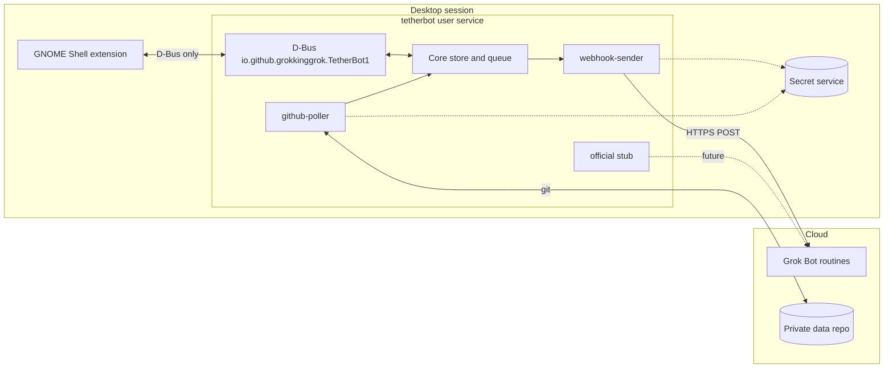

# TetherBot

Keep your GNOME desktop tethered to your AI bots.

**Status: pre-alpha, under construction.** Config, the item store, the action queue, the bridge process, the session bus service, secret-service storage, `tetherbotctl`, and `webhook-sender` are in place. The sender posts only when that adapter is enabled. `tetherbotctl webhook test` can also send one ping. The key dialog, `github-poller`, `repo setup`, and the extension UI are still stubs.

**Unofficial, not affiliated with xAI.**

TetherBot is a local bridge between a GNOME desktop and [Grok Bot](https://grok.com). A user-level daemon holds secrets and talks to the network. A GNOME Shell extension shows status in the top bar and sends button clicks back. The extension speaks only D-Bus.

The bridge is generic inside: transport adapters are plugins, so a later official API can be added without rewriting the extension. It is not a general-purpose AI hub. It shows what your own bots wrote, and it sends only the actions you click.

## Architecture



Desktop to bot uses a documented routine webhook: an authenticated HTTP POST. Bot to desktop has no official path today. An optional adapter polls a private git repository the bot can write. Both are off until you enable them.

## What you need to set up

The scaffold does not complete this setup. The list is the target, written out in [docs/SETUP.md](docs/SETUP.md).

1. GNOME Shell 50 on Wayland. Fedora 44 is the reference system.
2. Python 3.13 or newer, the OS package `python3-gobject` (PyGObject), the libsecret typelib (`Secret-1`), and `git`.
3. Grok Bot, signed in, plus a routine whose trigger is a webhook. [docs/prompts/bot-setup.md](docs/prompts/bot-setup.md) is the prompt to paste into the bot.
4. The webhook URL and key, stored in the desktop secret service by a bridge command. They never go in a chat, a config file, or this repository.
5. Optional, for bot-to-desktop updates: a private repository created from the future `template-repo/`, and a fine-grained token stored the same way.
6. Opt in per adapter, then enable the user service. Log out and back in before enabling the extension on Wayland.

[docs/prompts/coding-agent-setup.md](docs/prompts/coding-agent-setup.md) is the prompt for a coding agent that walks through install on your machine. `tetherbotctl repo setup` is not implemented, and the installer still does not place a launcher. The agent should stop when a command is missing.

## Repository map

| Path | What it is |
|---|---|
| [docs/SPEC.md](docs/SPEC.md) | Architecture source of truth |
| [docs/PROTOCOL.md](docs/PROTOCOL.md) | Item model, action envelope, schema rules |
| [docs/SETUP.md](docs/SETUP.md) | Human setup checklist |
| [docs/ROADMAP.md](docs/ROADMAP.md) | v0.1, v0.2, and v1.0 checklists, plus open questions |
| [docs/prompts/](docs/prompts/) | Copy-paste setup prompts |
| `bridge/tetherbot/` | Python package skeleton |
| `extension/` | GNOME 50 extension skeleton |
| `systemd/` | User unit and D-Bus activation templates |
| `scripts/` | Idempotent install and uninstall stubs |
| `data/` | D-Bus XML and example config |
| `tests/` | Pytest smoke test using the fake adapter |

The extension UUID is `tetherbot@grokkinggrok.github.io`. The D-Bus bus name and interface are `io.github.grokkinggrok.TetherBot1`, and the object path is `/io/github/grokkinggrok/TetherBot1`. The schema string stays `tetherbot/1`. The libsecret schema is `io.github.grokkinggrok.TetherBot.Secret`.

## Develop

```bash
python -m pip install pytest ruff
pytest
ruff check .
```

Runtime Python dependencies are none. PyGObject, libsecret, and git come from the operating system. GitHub Actions runs the same lint and tests on Python 3.13 from [.github/workflows/ci.yml](.github/workflows/ci.yml).

`scripts/install.sh` only copies templates into your user directories. It does not enable the service. The unit's `ExecStart` is still `/bin/false`; the installer does not place `~/.local/bin/tetherbot` or `~/.local/bin/tetherbotctl` yet. `scripts/uninstall.sh` removes those templates and leaves the secret service alone. From a checkout, `python -m tetherbot` loads config and state and then waits in the main loop. `python -m tetherbot.ctl` is the status, enable, secret set, and webhook test command.

## License

[GPL-2.0-or-later](LICENSE). GNOME Shell extensions reviewed on extensions.gnome.org need a GPL-compatible license, and GPL-2.0-or-later is the usual choice for shell extensions. The design spec agrees. The extension and the bridge share that license so the project can be packaged together.

## Privacy, in one paragraph

After a real install, each adapter is still opt-in. The only planned outbound traffic is an action batch you trigger, sent to the webhook you configured, and, if you enable it, files the bridge owns pushed to your private repository. The extension does not read the screen, files, clipboard, or other apps. Details are in [docs/SPEC.md](docs/SPEC.md) section 14. A standalone privacy document is a v0.2 checklist item.
