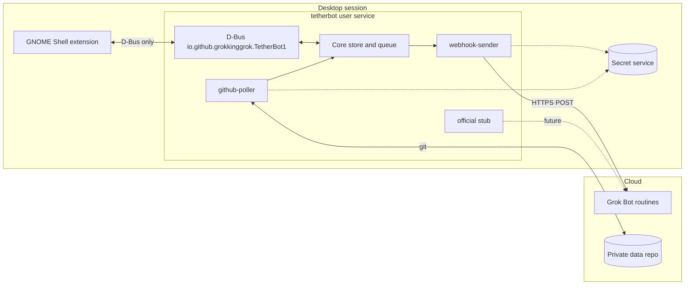

# TetherBot

Keep your GNOME desktop tethered to your AI bots.

**Status: pre-alpha.** Config, the item store, the action queue, the bridge process, the session bus service, secret-service storage, `tetherbotctl`, `webhook-sender`, and `github-poller` are in place. `scripts/install.sh` installs the app and the launchers, and the user unit starts `%h/.local/bin/tetherbot`. The sender posts only when that adapter is enabled. `tetherbotctl webhook test` can also send one ping. The poller reads a `file://` repository and an `https://github.com` repository through `git-credential-tetherbot`. `ssh-deploy-key` does not run git yet. The extension shows an indicator, a bots/asks/todos popup, and notifications, and it talks only over the session bus. Settings hold the poll interval, the undo length, per-bot notifications, hidden bots, and a key handoff. The key dialog is owned by the bridge. Money and watch is later. Desktop checks are in [docs/MANUAL-CHECKS.md](docs/MANUAL-CHECKS.md).

**Unofficial, not affiliated with xAI.**

TetherBot is a local bridge between a GNOME desktop and [Grok Bot](https://grok.com). A user-level daemon holds secrets and talks to the network. A GNOME Shell extension shows status in the top bar and sends button clicks back. The extension speaks only D-Bus.

The bridge is generic inside: transport adapters are plugins, so a later official API can be added without rewriting the extension. It is not a general-purpose AI hub. It shows what your own bots wrote, and it sends only the actions you click.

## Architecture



Desktop to bot uses a documented routine webhook: an authenticated HTTP POST. Bot to desktop has no official path today. An optional adapter polls a private git repository the bot can write. Both are off until you enable them.

## What you need to set up

The human checklist is [docs/SETUP.md](docs/SETUP.md). The copy-paste checks are [docs/MANUAL-CHECKS.md](docs/MANUAL-CHECKS.md).

1. GNOME Shell 50 on Wayland. Fedora 44 is the reference system.
2. Python 3.13 or newer, the OS package `python3-gobject` (PyGObject), the libsecret typelib (`Secret-1`), and `git`.
3. Grok Bot, signed in, plus a routine whose trigger is a webhook. [docs/prompts/bot-setup.md](docs/prompts/bot-setup.md) is the prompt to paste into the bot.
4. The webhook URL and key, stored in the desktop secret service by a bridge command. They never go in a chat, a config file, or this repository.
5. Optional, for bot-to-desktop updates: a private repository created from `template-repo/`, and a fine-grained token stored the same way (`tetherbotctl secret set github-token`).
6. Opt in per adapter, then enable the user service (`systemctl --user enable --now tetherbot`, or `scripts/install.sh --enable`). Log out and back in before enabling the extension on Wayland.

[docs/prompts/coding-agent-setup.md](docs/prompts/coding-agent-setup.md) is the prompt for a coding agent that walks through install on your machine. `tetherbotctl repo setup` is not a command. Enabling the repo adapter clones the remote. The agent should stop when a command is missing.

## Repository map

| Path | What it is |
|---|---|
| [docs/SPEC.md](docs/SPEC.md) | Architecture source of truth |
| [docs/PROTOCOL.md](docs/PROTOCOL.md) | Item model, action envelope, schema rules |
| [docs/SETUP.md](docs/SETUP.md) | Human setup checklist |
| [docs/MANUAL-CHECKS.md](docs/MANUAL-CHECKS.md) | M1–M8 and M10–M14 on one desktop |
| [docs/ROADMAP.md](docs/ROADMAP.md) | v0.1, v0.2, and v1.0 checklists, plus open questions |
| [docs/privacy.md](docs/privacy.md) | What stays on the machine, and what the bridge sends |
| [docs/BRIDGE.md](docs/BRIDGE.md) | How bots reach the desktop today, and what a native channel would replace |
| [docs/BOT-WRITER.md](docs/BOT-WRITER.md) | Bot-side writer for `feed/<bot>.json` |
| [docs/prompts/](docs/prompts/) | Copy-paste setup prompts |
| `bridge/tetherbot/` | Python package |
| `extension/` | GNOME 50 extension |
| `template-repo/` | Private data repository skeleton |
| `systemd/` | User unit and D-Bus activation |
| `scripts/` | Idempotent install, uninstall, extension install, fake webhook, secret sweep |
| `data/` | D-Bus XML and example config |
| `tests/` | Pytest smoke test using the fake adapter |

The extension UUID is `tetherbot@grokkinggrok.github.io`. The D-Bus bus name and interface are `io.github.grokkinggrok.TetherBot1`, and the object path is `/io/github/grokkinggrok/TetherBot1`. The schema string stays `tetherbot/1`. The libsecret schema is `io.github.grokkinggrok.TetherBot.Secret`.

## Develop

```bash
python -m pip install pytest ruff
pytest
ruff check .
```

Runtime Python dependencies are none. PyGObject, libsecret, and git come from the operating system. GitHub Actions runs the same lint and tests on Python 3.13 from [.github/workflows/ci.yml](.github/workflows/ci.yml).

`scripts/install.sh` copies the app, launchers, unit, and D-Bus activation file. It does not enable the service unless you pass `--enable`. `scripts/uninstall.sh` removes those files and leaves the secret service alone. `--purge` also removes config, state, and clones. From a checkout, `python -m tetherbot` is the bridge and `python -m tetherbot.ctl` is `tetherbotctl`. `make install-extension` copies the extension into your user extensions directory. Log out and back in before enabling it on Wayland.

## License

[GPL-2.0-or-later](LICENSE). GNOME Shell extensions reviewed on extensions.gnome.org need a GPL-compatible license, and GPL-2.0-or-later is the usual choice for shell extensions. The design spec agrees. The extension and the bridge share that license so the project can be packaged together. The tag icon is from Lucide and stays under the ISC license. The notice is in [THIRD-PARTY.md](THIRD-PARTY.md).

## Privacy, in one paragraph

After a real install, each adapter is still opt-in. The only planned outbound traffic is an action batch you trigger, sent to the webhook you configured, and, if you enable it, files the bridge owns pushed to your private repository. The extension reads the clipboard only to keep a local text history on this machine. A password-like copy is skipped unless Settings keeps it hidden for 30 seconds. Pins, tags, and edits stay in that local history. Search the web opens the desktop browser's own search engine only when that button is pressed. If that engine cannot be read, it uses the search fallback shown in Settings. It does not read the screen or files outside the bridge, and clipboard text is not sent to a bot. Details are in [docs/SPEC.md](docs/SPEC.md) section 14. A standalone privacy document is a v0.2 checklist item.
