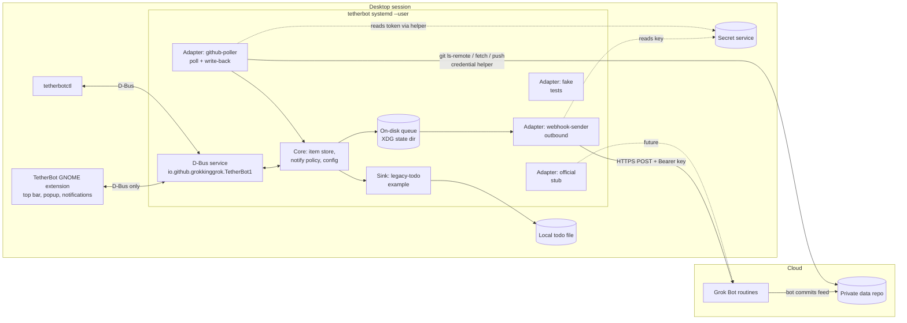

# TetherBot: build spec

Status: pre-alpha. This file is the architecture source of truth.
Targets: GNOME Shell 50, Wayland, Fedora 44, Python 3.13+.

Read this whole file before writing code. Anything marked **TBD, verify** is not confirmed. Check it before you rely on it, and do not fill the gap with a guess.

Decided names: bus name and interface `io.github.grokkinggrok.TetherBot1`, object path `/io/github/grokkinggrok/TetherBot1`, schema `tetherbot/1`, extension UUID `tetherbot@grokkinggrok.github.io`, libsecret schema `io.github.grokkinggrok.TetherBot.Secret`. After release, the bus name and the schema major version stay stable. The project is unofficial and not affiliated with xAI. A concrete legacy inbox format stays out of this public repository. See section 16.

Examples use the fictional bot id `primary`.

## 0. Summary

The project has two deliverables:

1. **tetherbot**: a local `systemd --user` daemon. It owns the D-Bus name `io.github.grokkinggrok.TetherBot1` on the session bus. It holds all secrets and does all network I/O through pluggable **transport adapters**. Local consumers are **sinks**.
2. **TetherBot for GNOME** (the extension): a top-bar indicator, notifications with actions, a small popup, and later a Quick Settings tile. It talks only to the bridge over D-Bus. It makes no network calls, holds no secrets, and never talks to Git hosting itself.

There are two traffic directions:

- **Desktop to Grok Bot** uses the official, documented path: an authenticated HTTP POST to a routine's webhook URL. This is the core.
- **Grok Bot to desktop** has no official path today. The working approach is the bot writing to a private git repository that the bridge polls. This is an optional adapter, not the core.

An optional example sink, `legacy-todo`, shows how an older single-repo todo sync can move into the bridge. It is not required for the webhook path. See section 11.

## 1. Goals and non-goals

### Goals

- G1. Show glanceable bot status on the GNOME top bar: per-bot state, open asks, todos, and money or watch items.
- G2. Send desktop actions (approve, veto, done, run now) to a bot through official routine webhooks, with a persistent queue and retry.
- G3. Keep the bridge generic inside: adapters and sinks are plugins behind one interface, so an official Grok Bot API, a desktop hook, or another service can be added without touching the extension.
- G4. Offer an example path that replaces a legacy single-repo todo sync while keeping that consumer's files byte-compatible.
- G5. Stay local-first, opt-in, and explicit about permissions. Nothing runs or connects until the user turns it on.
- G6. Pass extensions.gnome.org review by v1.0.

### Non-goals (v1)

- Chat with bots, streaming replies, or a chat window. Quick replies come later (section 9.3).
- Reverse-engineering the Grok Bot desktop app, its local storage, or private network APIs.
- A generic "AI hub" marketed to the public. The bridge is generic internally only.
- Paying, buying, or moving money. Bills are read-only reminders.
- Windows, macOS, KDE. (The D-Bus API makes a KDE client possible later.)
- Running when the user is logged out. A user unit is enough.

## 2. Language choice: Python with PyGObject

Use **Python 3.13+ with PyGObject** (`gi.repository`: `Gio` for D-Bus and network status, `GLib` main loop, `Secret` for libsecret).

- The reference desktop already ships `python3-gobject`, `libsecret`, and `git`. The bridge needs no pip dependencies at runtime. That keeps the installer small and leaves room for a COPR package later.
- Gio's D-Bus server API, libsecret, and `Gio.NetworkMonitor` are first-class through GObject Introspection. A pure-Python D-Bus library would add a dependency and a second event loop next to libsecret.
- Rust would give a smaller memory footprint and stronger typing. That matters less for a daemon that wakes about every two minutes. Revisit only if the bridge grows a heavy workload.

HTTP: use `urllib.request` in a worker thread, with results posted back to the GLib loop via `GLib.idle_add`. Do not add `requests` or `httpx`. Git: call the `git` CLI with `subprocess`.

Importing the package does not import `gi`, so the unit tests run without the system libraries.

## 3. Architecture



Adapters turn remote data into **items** in the core store. The core diffs items, emits D-Bus signals, and decides which changes deserve a notification. User actions come in over D-Bus, get an action id, go to the on-disk queue, and are drained by whichever adapter owns that bot's outbound route.

## 4. Components and repository layout

### 4.1 This repository

```
README.md                       pitch, status, architecture, license
LICENSE                         GPL-2.0-or-later
CONTRIBUTING.md
AGENTS.md                       instructions for coding agents
pyproject.toml                  no runtime pip dependencies
bridge/tetherbot/               Python package
  __init__.py                   SCHEMA_VERSION, package version
  __main__.py                   starts the bridge process
  daemon.py                     config, store, queue, and the GLib main loop
  service.py                    session API on the store and queue
  secrets.py                    libsecret read and write, no file fallback
  model.py                      item and action envelope, secret guard
  version_gate.py               fail closed on an unknown major
  config.py                     config.toml loader
  log.py                        redacting log
  store.py                      item store and diff
  notify_policy.py              notify dedupe, snooze, due soon
  queue.py                      on-disk action queue
  files.py                      private JSON writes with fsync
  dbus_service.py               bus name and session export
  ctl.py                        tetherbotctl: status, enable, secret set, webhook test
  credential.py                 git credential helper (libsecret, no files)
  sweep.py                      secret sweep used by scripts/secret-sweep.py
  adapters/base.py              adapter interface
  adapters/fake.py              fixture-backed test adapter
  adapters/webhook_sender.py    outbound POST, retry table, re-paste
  adapters/github_poller.py     file:// and https-token poll, schema gate, owned-path write-back
  adapters/official.py          future official API stub
  sinks/base.py                 sink interface
  sinks/legacy_todo.py          example legacy todo sync
data/
  io.github.grokkinggrok.TetherBot1.xml     D-Bus introspection XML (source of truth)
  config.example.toml
extension/                      GNOME 50 ESM skeleton
  metadata.json  extension.js  view.js  prefs.js  stylesheet.css
  io.github.grokkinggrok.TetherBot1.xml   copy of the bus interface, checked against data/
systemd/                        user unit and D-Bus activation (ExecStart is the launcher)
scripts/install.sh  uninstall.sh  install-extension.sh
scripts/fake-webhook.py  secret-sweep.py
scripts/launchers/              tetherbot, tetherbotctl, git-credential-tetherbot
template-repo/                  private data repo skeleton (feed example, ownership)
docs/
  SPEC.md  PROTOCOL.md  SETUP.md  ROADMAP.md  MANUAL-CHECKS.md
  prompts/bot-setup.md  prompts/coding-agent-setup.md
tests/                          pytest, including store, queue, config, daemon, D-Bus, secrets, ctl, and the credential helper
.github/workflows/ci.yml        ruff and pytest on Python 3.13
```

`python -m tetherbot` loads `config.toml`, opens the item cache and the action queue under the state directory, and runs a GLib main loop until SIGINT or SIGTERM. On that loop it owns `io.github.grokkinggrok.TetherBot1` on the session bus. A missing config leaves the state `unconfigured`. A refused config leaves the state `failed_closed` and the process keeps running. The log line names the state and the reason, never a secret. An enabled `webhook-sender` posts from the action queue. An enabled `github-poller` polls a `file://` remote or an `https://github.com` remote and writes only `desktop/` and `log/desktop/`. `https-token` runs git through `git-credential-tetherbot` (`python -m tetherbot.credential`), which reads the token from libsecret. `ssh-deploy-key` is accepted in config and then fails closed without spawning git (`deploy key is not configured`). Other enabled adapters and sinks are not started, so those names stay in a degraded `not started` reason. `scripts/install.sh` copies the app and the launchers. The unit `ExecStart` is `%h/.local/bin/tetherbot`. D-Bus activation starts `tetherbot.service`.

`python -m tetherbot.ctl` is `tetherbotctl`. It reports status from the running bridge when the bus name is owned, and otherwise from the local config. `enable` and `disable` call `SetAdapterEnabled` when the bridge is on the bus, and otherwise rewrite that adapter's `enabled` line. `secret set` reads with `getpass`. `webhook test <bot>` prints only the HTTP status. `repo setup` is not part of this command yet. `scripts/install.sh` places `~/.local/bin/tetherbot`, `~/.local/bin/tetherbotctl`, and `~/.local/bin/git-credential-tetherbot`.

Later milestones add, and should not be invented early: `tools/keys_dialog.py`, `desktop/outbox`, extension prefs, and `docs/privacy.md`. `template-repo/` and the credential helper are already in the tree so the v0.1 manual checks can run.

The extension UUID is `tetherbot@grokkinggrok.github.io`. The README and `extension/metadata.json` label the project unofficial and not affiliated with xAI.

### 4.2 Installed locations

| What | Path |
|---|---|
| Daemon and tools | `$XDG_DATA_HOME/tetherbot/app/` (default `~/.local/share/tetherbot/app/`). Launchers in `~/.local/bin/`: `tetherbot`, `tetherbotctl`, `git-credential-tetherbot` |
| Config (no secrets) | `$XDG_CONFIG_HOME/tetherbot/config.toml` (default `~/.config/tetherbot/config.toml`) |
| State, queue, logs | `$XDG_STATE_HOME/tetherbot/` (default `~/.local/state/tetherbot/`): `queue/`, `items.json` cache, `bridge.log`, `backups/` |
| Repo clones | `$XDG_DATA_HOME/tetherbot/repos/<name>/` |
| Unit | `$XDG_CONFIG_HOME/systemd/user/tetherbot.service` |
| D-Bus activation | `$XDG_DATA_HOME/dbus-1/services/io.github.grokkinggrok.TetherBot1.service` with `SystemdService=tetherbot.service` |
| Secrets | Desktop secret service (GNOME Keyring via libsecret) only |

### 4.3 Template private repository: `tetherbot-data`

Users create this from `template-repo/` as a **private** repository. Each path has exactly one writer, so git does not have to merge the same file from both ends.

```
tetherbot-data/
  README.md                 ownership table and a pointer to docs/PROTOCOL.md
  bridge.json               user-owned: schema, bot list, timezone
  feed/<bot>.json           that bot only: status and items
  log/feed/<bot>/YYYY-MM.jsonl
  desktop/state.json        bridge only
  desktop/outbox/YYYY-MM.jsonl
  log/desktop/YYYY-MM.jsonl
```

The ownership table is normative in [PROTOCOL.md](PROTOCOL.md). The bridge refuses to stage any path it does not own.

A legacy todo sink may own extra paths. Those paths are part of that sink's contract, not of the public feed schema. See section 11.

## 5. Protocol

The normative field tables, JSON examples, and repository ownership rules are in [PROTOCOL.md](PROTOCOL.md). The rules below are the ones implementers must not weaken.

### 5.1 Versioning

- Every new file and payload has a `schema` field. New files use the string `"tetherbot/1"`.
- Within major version 1, changes are additive only. Readers ignore unknown fields.
- An unknown major version means **fail closed** for that source: stop reading that file, keep the last good items marked stale, set bridge `State` to `degraded`, and report `"<source>: unsupported schema tetherbot/2, update tetherbot"`. Never guess.
- Unknown `kind` values are kept and shown only as a generic notification, never as actionable.
- `version_gate.py` is the shared checker. `github-poller` will additionally declare any legacy schema it understands. `webhook-sender` declares the profile `routine-webhook-2026-10` (section 7.2). A response outside that profile pauses the route.

### 5.2 Items and actions

- The global key is `<bot>/<id>`.
- `snooze` does not leave the machine by default.
- The action POST body carries no secret. The key is only in the `Authorization: Bearer` header.
- `action_id` is stable so the bot can drop a duplicate after an ambiguous timeout.
- The secret guard in PROTOCOL.md redacts secret-shaped item text before it reaches a todo file or a notification.

### 5.3 Legacy inbox mapping

Decided: a concrete legacy inbox format stays out of this public repository. The in-tree sink stays generic and does not publish a field map. A sink maintained outside this repo must:

- Be read-only toward the bot-owned inbox file.
- Map entries into the item model in PROTOCOL.md.
- Fail closed when the legacy schema version is unknown, leaving the local todo file untouched.
- Keep its field map out of this repository.

## 6. D-Bus interface

Bus: session. Name: `io.github.grokkinggrok.TetherBot1`. Object: `/io/github/grokkinggrok/TetherBot1`. Interface: `io.github.grokkinggrok.TetherBot1`.

Lists of items pass as JSON strings (`s`), so the item model can grow without breaking the D-Bus signature. Small, hot values are typed properties. `data/io.github.grokkinggrok.TetherBot1.xml` is the source of truth. Bump the interface to `io.github.grokkinggrok.TetherBot2` only for breaking changes.

### 6.1 Properties (all read-only, with `PropertiesChanged`)

| Name | Type | Meaning |
|---|---|---|
| `Version` | s | Bridge version, such as `0.1.0` |
| `ProtocolVersions` | as | For example `["tetherbot/1"]` |
| `State` | s | `unconfigured`, `ok`, `degraded`, `offline`, `failed_closed`, `paused` |
| `StateReason` | s | Short human text for the current state |
| `Mode` | s | `webhook-only`, `repo-only`, `full` |
| `Counts` | a{su} | `asks`, `todos`, `watch`, `notifications`, `waiting`, `queued` |
| `Bots` | s | JSON list: `{name, display_name, state, summary, last_seen, routes:{outbound: bool}}` |
| `LastSync` | x | Unix time of the last successful poll (0 if never) |
| `QueueLength` | u | Pending outbound actions |

### 6.2 Methods

| Signature | Behavior |
|---|---|
| `GetItems(s filter_json) -> s items_json` | Filter keys: `kinds`, `bots`, `status`, `include_snoozed`. Returns sorted items. |
| `GetItem(s key) -> s item_json` | One item, or D-Bus error `io.github.grokkinggrok.TetherBot1.Error.NotFound` |
| `PerformAction(s key, s action, s args_json) -> s action_id` | Validates that the action is listed on the item, enqueues it, returns at once. The result arrives later as `ActionResult`. |
| `Snooze(s key, s until_iso) -> b` | Local only. Hides the item and suppresses notifications until then. |
| `MarkSeen(as keys) -> ()` | Clears the "new" badge |
| `SendToBot(s bot, s payload_json) -> s action_id` | Generic outbound (for example `run_now`). Payload must validate against the action envelope. |
| `SyncNow() -> ()` | Polls all inbound adapters now (rate-limited to once per 30 s) |
| `OpenChat(s bot) -> b` | Launches Grok Bot. A deep link to a bot's chat is **TBD, verify** (section 16). Fallback: launch the app's desktop entry. |
| `GetAdapters() -> s` | JSON: name, enabled, state, version gate, last error, next poll |
| `SetAdapterEnabled(s name, b enabled) -> ()` | Opt-in switch, saved to `config.toml` |
| `RequestSecretEntry(s slot) -> b` | The bridge opens its own dialog (section 8.3). Secrets never pass over D-Bus. |
| `ForgetSecret(s slot) -> ()` | Deletes that keyring item |
| `GetQueue() -> s` | Pending and parked actions, no secrets |
| `RetryParked(s action_id) -> ()`, `DropQueued(s action_id) -> ()` | Queue management |

### 6.3 Signals

| Signature | When |
|---|---|
| `ItemsChanged(as added, as updated, as removed)` | After each store diff, with global keys |
| `NotificationRequested(s item_json, s reason)` | Notify policy says show one (`new`, `changed`, `due_soon`, `delivery_failed`) |
| `ActionResult(s action_id, s result, s detail)` | `result`: `accepted` (HTTP 200, run started), `queued_retry`, `parked`, `rejected_key`, `dropped` |
| `StateChanged(s state, s reason)` | Mirrors the property for clients that do not watch properties |

`ForgetSecret` deletes that slot from libsecret and does not take the secret value. `RequestSecretEntry` returns false until the key dialog exists; the secret still does not cross D-Bus. A locked or missing keyring sets the bridge state to `degraded` with reason `keyring locked` and never writes a secret file. `OpenChat` returns false until the Grok Bot desktop entry id is known. `SyncNow` is limited to once per 30 seconds and does not poll until an inbound adapter is running, so `LastSync` stays 0. `PerformAction` enqueues `approve`, `veto`, and `done` only. `snooze` stays on `Snooze`. `ActionResult` is emitted when a later sender finishes a post.

Access control: any process in the user session can call the bridge. That is the normal session-bus trust boundary. The bridge never exposes secrets over D-Bus, so the worst a hostile local app can do is queue actions. It already has the user's full privileges anyway. Write this down in `docs/privacy.md` when that file is added (v0.2).

## 7. Adapters

### 7.1 Adapter interface (`adapters/base.py`)

```python
class Adapter(Protocol):
    name: str                       # "github-poller", "webhook-sender", ...
    direction: frozenset[str]       # {"inbound"}, {"outbound"}, or both
    def start(self, ctx) -> None: ...
    def stop(self) -> None: ...
    def poll(self) -> PollResult: ...
    def send(self, bot: str, batch: list) -> SendResult: ...
    def status(self) -> AdapterStatus: ...
```

`ctx` will carry the store, queue, secrets, config, clock, and log. Sinks (`sinks/base.py`) get `on_items(snapshot, diff)` and may write back through an adapter that owns a repo. All adapters are off until enabled in config. Adapter code never logs a secret, a full URL that contains a key, or an Authorization header.

### 7.2 `webhook-sender` (outbound, official, core)

What is documented today (Grok Bot help, "Routines", and the routines skill, read 2026-10-17):

- A bot can have a routine with a `webhook` trigger. The user asks the bot in chat to add one.
- On desktop, open the routine. Its **Webhook** section shows three fields: **POST to** (the URL), **key** (the secret), and **header** (the full header, ready to copy).
- The sender makes an HTTP `POST` to that URL with `Authorization: Bearer <key>`. A JSON body is optional. The bot receives the body together with the routine instruction.
- **200** means Grok Bot accepted the call and started a run. It does not mean the bot finished. Any other status means no run started.
- Known issue: some runs fail with "Automation run rate limit exceeded", from a limit all Grok Bot routines share. Such runs are not retried automatically by the product. Users report this as HTTP 400 when it hits at call time (**TBD, verify** the exact status and body).
- Each run spends the user's Grok Bot usage.
- There is no documented key rotation. A new key needs a new routine or support (**TBD, verify**).

Unknown, so **TBD, verify** each before relying on it: maximum body size, required `Content-Type` (send `application/json`), whether the response body has a run id, rate-limit numbers, and whether 401 and 403 are the statuses for a bad key.

Behavior to implement in v0.1:

1. **Routes.** `config.toml` maps each bot to at most one outbound route: `[bots.primary] webhook_slot = "primary-actions"`. The URL and key both live in the secret service under that slot. The URL is sensitive too, because it may carry an id.
2. **Coalesce.** Actions for one bot wait in a debounce window (default 20 s, max 120 s) and go out as one batch, one POST, one run.
3. **Pace.** At most 1 POST per route per 60 s, and at most 30 per route per day (configurable). Over budget, actions wait in the queue and `Counts.queued` shows it.
4. **Queue.** Every action is written to the state `queue/<action_id>.json` (mode 0600, no secrets) with `fsync` before `PerformAction` returns. A restart resumes the queue.
5. **Retry and backoff:**

| Response | Handling |
|---|---|
| 200 | `accepted`. Delete from queue. Trigger a poll burst (section 7.3). |
| 400 | Assume the shared rate cap. Retry with exponential backoff and jitter: 60 s, 2 m, 4 m, 8 m, up to 30 m, max 8 tries, then `parked` with a notification. If the body clearly says the payload is invalid (**TBD, verify** the wording), park at once. |
| 401, 403 | `rejected_key`. Stop that route (fail closed), park its actions, set `State=degraded`, show the "Re-paste key" notification. |
| 404, 410 | The routine is gone or the URL is wrong. Same as a bad key, with text "Routine not found". |
| 408, 429, 5xx, network error, TLS error | Backoff as for 400, no try limit while offline (`Gio.NetworkMonitor`) |
| Timeout after the request was sent | Ambiguous: the run may have started. Retry once after backoff with the same `action_id`, so the bot can drop the duplicate. |

6. **Re-paste key.** The notification action calls `RequestSecretEntry("<slot>")`. The dialog names where the key lives ("Bot details, Routines, the routine, Webhook, key") and has two fields (URL and key). After saving, the bridge sends a `{"type":"ping"}` test only if the user ticks "Send a test now", because a test spends usage. The dialog is not built yet, and `RequestSecretEntry` returns false. Until it exists, `tetherbotctl secret set <slot>` stores the secret and, when the bridge is on the bus, retries parked actions for bots that use that slot. HTTP 400 always uses the rate-cap table: the invalid-payload wording is still **TBD, verify**. A 200 records the section 7.3 poll burst. It does not start `github-poller`; a running poller consumes those times.
7. **Test path.** `tetherbotctl webhook test <bot>` POSTs `{"schema":"tetherbot/1","type":"ping"}` with `Authorization: Bearer` and `Content-Type: application/json`. It prints the status code, never the key or the URL, and does not follow redirects.

The routine on the bot side (prompt A) treats the body as data: it acts only on known `action` values for items it owns, and treats `note` text as a message from the user, not as instructions that widen what the routine may do.

### 7.3 `github-poller` (inbound poll plus write-back, optional)

- **Auth.** Two modes:
  - `https-token` (default for new users): a fine-grained personal access token scoped to one repo. Permissions: Contents read and write (read only if write-back is off), Metadata read. Suggest a 90-day expiry. The remote URL is a plain `https://` git URL. The token is supplied only by `git-credential-tetherbot`, set on that clone only: `credential.helper` reset to empty, then the bridge helper, plus `credential.useHttpPath=true`. The helper answers only for `protocol=https`, `host=github.com`, and the exact configured path. It reads the token from libsecret, prints `username=x-access-token` and `password=...` to git, and nothing else. The token never appears in a URL, `.git/config`, an environment variable, argv, or a log. `GIT_TERMINAL_PROMPT=0`.
  - `ssh-deploy-key`: a repo-only deploy key via `core.sshCommand`. No token at all.
- **v0.1 transport.** Git runs for a `file://` remote with an absolute path and no userinfo, and for `https-token` (a plain `https://github.com/...` URL). The https clone gets `credential.helper` reset to empty, then `git-credential-tetherbot --slot github-token`, and `credential.useHttpPath=true`, on that clone only. `ls-remote` and `clone` pass the same helper with `git -c`, because those commands do not have a clone config yet. The helper answers only `protocol=https`, `host=github.com`, and the exact path of the configured remote. If the helper executable is missing, https fails closed without spawning git (`credential helper is not installed`). `ssh-deploy-key` stays deferred: it is accepted in config and then fails closed without spawning git (`deploy key is not configured`). A URL with userinfo is refused. `desktop/outbox` stays v0.2.
- **Cheap change check.** Every poll first runs `git ls-remote <remote> refs/heads/<branch>` and compares the SHA with the last one seen. Only on a change does it run `git pull --rebase --autostash` and re-read files. An optional REST mode (`GET /repos/{owner}/{repo}/commits/{branch}` with `If-None-Match`) can replace `ls-remote`. GitHub documents that a 304 to an authenticated conditional request does not count against the primary rate limit (5,000 requests per hour for a token). The client reads `x-ratelimit-remaining` and backs off below 10%. It sends the token as an `Authorization` header, through the same helper code path, never in a URL. Rate limits for plain git over HTTPS are not published in detail (**TBD, verify**). Polling every 2 minutes is about 720 checks a day.
- **Interval.** Default 120 s, minimum 60 s, maximum 900 s. Pause while offline (`Gio.NetworkMonitor`) and stretch to 600 s while the screen is locked (`org.gnome.ScreenSaver` `ActiveChanged`). After a webhook 200, run a **burst**: polls at +30 s, +60 s, +120 s, +240 s, then back to normal. On errors, back off: 2x up to 15 m.
- **Reading.** Parse `feed/*.json` (schema-gated) and `desktop/state.json`. A JSON parse error in one file marks that source stale. It never wipes items.
- **Write-back.** Only owned paths (section 4.3), plus any paths a enabled sink explicitly owns. Commit identity for bridge-owned paths: `TetherBot <noreply@localhost>`. Push rejected: `pull --rebase` and retry, max 3. A rebase conflict aborts the rebase and fails closed.
- **Repo-only outbox.** If a bot has no webhook route, actions append to `desktop/outbox/YYYY-MM.jsonl` (same envelope as PROTOCOL.md) and the bot sees them on its next scheduled run. This is slow and spends no extra runs. Grok Bot git-hosting routine triggers cover PR, review, CI, and issue-assigned events, not plain pushes, so a push to the data repo cannot wake a bot by itself.

### 7.4 `official` (stub)

Present and disabled. It documents where an official Grok Bot API, SDK, outbound webhook, or local desktop hook would plug in: inbound `poll()` or a push subscription, outbound `send()`. Enabling it with no implementation sets the adapter state to `unavailable: no official API known`. When an official path ships, it takes priority over `github-poller` for the same bot, and the repo adapter becomes optional for that bot.

### 7.5 `fake` (tests and demos)

Reads JSON fixtures, as `tests/fixtures/fake/` does. Outbound `send()` records batches and can be told to answer a scripted status. A future local HTTP server, `tests/fake_webhook_server.py`, is for end-to-end tests of the real webhook adapter. A private D-Bus method `io.github.grokkinggrok.TetherBot1.Debug.Inject` may exist only when the bridge runs with `--debug`.

### 7.6 `legacy-todo` sink

Generic module only. See section 11. Off by default. A concrete legacy inbox format stays out of this public repository, so this tree does not implement one. The webhook milestone does not depend on this sink.

## 8. Security and secrets

### 8.1 Rules

- Secrets live only in libsecret (GNOME Keyring, login collection). They do not go in `config.toml`, gsettings, dconf, environment variables, unit files, logs, the queue, D-Bus messages, or the extension.
- libsecret schema `io.github.grokkinggrok.TetherBot.Secret` with attributes `{kind: "webhook" | "github-token", slot: "<slot>"}`. Webhook items store a JSON blob `{url, key}`. Labels are readable in Seahorse, for example "tetherbot: primary actions webhook".
- If the keyring is locked or missing, the affected adapters wait in state `degraded: keyring locked`, and the bridge shows one notification. It never falls back to a plain file.
- The git token is optional, fine-grained, one repo, and the user picks the expiry. If REST mode sees the `github-authentication-token-expiration` header, warn 7 days ahead.
- The token goes only through the git credential helper, never in a URL.
- Redaction: one logging filter masks secret-shaped patterns, plus the exact stored values, before writing to the journal or `bridge.log`.

### 8.2 Process and permissions

- The extension holds no secrets and makes no network calls. Reviewers can check that by searching it for `Soup`, `Gio.SocketClient`, `fetch`, and `GLib.spawn`. The only imports it needs are `Gio` (D-Bus proxy), `GLib`, `St`, `Clutter`, and Shell UI modules.
- Unit hardening that works for user services: `NoNewPrivileges=yes`, `LockPersonality=yes`, `RestrictRealtime=yes`, `RestrictSUIDSGID=yes`, `UMask=0077`. Test each one on Fedora 44. Some sandboxing options need user namespaces in user units (**TBD, verify** whether `ProtectSystem=strict` with `ReadWritePaths=` works there). The unit sets the options in the first sentence. `ExecStart` is `%h/.local/bin/tetherbot` with `Type=dbus` and `BusName=io.github.grokkinggrok.TetherBot1`. D-Bus activation uses `SystemdService=tetherbot.service`. `Exec` in the activation file points at the installed launcher as a fallback. `scripts/install.sh` copies both files.
- Network destinations are fixed: the webhook host from the stored URL (scheme `https`), plus `github.com` and `api.github.com` for the git adapter. The adapter refuses any other host for a git-hosting route.

### 8.3 Key entry outside the shell

`RequestSecretEntry(slot)` makes the bridge spawn a small GTK4 and libadwaita window owned by the bridge process tree. It writes straight to libsecret and exits. The extension's prefs window only has a "Set up keys..." button that calls this method. That keeps secrets out of `gnome-shell` and out of the prefs process. Until that dialog exists, `RequestSecretEntry` returns false. A terminal fallback exists: `tetherbotctl secret set <slot>` reads with `getpass` and does not echo. A slot named `github-token` asks for the token. Any other slot asks for the webhook URL and key. Success prints `stored <slot>` and nothing else.

## 9. Extension UI

### 9.1 v1 (glanceable status)

- **Top-bar indicator.** A glyph with a badge that counts open asks plus todos owned by the user (configurable). Colors: normal, attention (open asks), and a dimmed icon when the bridge is `unconfigured`, `failed_closed`, or not running. The tooltip and accessible name read like "TetherBot: 2 asks, 3 todos".
- **Popup menu:**
  1. A per-bot row: name, state dot, one-line summary, "last seen 4 m ago". Click opens the chat (`OpenChat`).
  2. **Asks**: title, bot, due, with inline Approve and Veto buttons when listed in `actions`.
  3. **Todos**: open items for the user, with Done (sends `done` if the bot has a route; otherwise marks done locally when a local file is the source of truth).
  4. **Money and watch**: bills and watch items, read-only, sorted by date, with `amount`.
  5. Footer: bridge state, queued count, "Sync now", "Settings".
- **Notifications** (MessageTray, one source): one per `NotificationRequested`. Buttons come from the item: Approve, Veto, Snooze (1 h, or tomorrow 09:00), and Open chat. Notify on first sight, plus a `due_soon` nudge. GNOME Do Not Disturb applies. Delivery failures and "Re-paste key" use the same source. The bridge dedupes by key and `updated_at`.
- **Empty and error states** are explicit, including "Bridge not running", "Webhook-only mode: bot updates need the repo adapter", and "This feed uses a newer protocol. Update TetherBot."
- **Prefs** (`prefs.js`, Adw): which counts drive the badge, show or hide each section, notification on or off per bot, and "Set up keys...". UI settings only, in the extension's gsettings schema. The schema file arrives with the prefs milestone. The scaffold prefs window is an empty page.

Implementation notes for GNOME Shell 50: ESM imports (`resource:///org/gnome/shell/...`), `Gio.DBusProxy` built from the shipped XML with `Gio.DBusProxy.makeProxyWrapper`, all calls async (`*Remote`, no `*Sync`), and the proxy, signal handlers, notification source, and indicator dropped in `disable()`. Watch the bus name (`Gio.bus_watch_name`) so the indicator flips state when the bridge starts or stops. The proxy is created with `DO_NOT_AUTO_START`. Notifications use `MessageTray.Notification({source, title, body})` and `addAction(label, callback)` (the Shell 49/50 shape). On Wayland, shell code reloads only after a logout and login, so develop in a nested devkit session (`dbus-run-session gnome-shell --devkit` on 49 and later, **TBD, verify** the flag and package on Fedora 44).

The indicator shows asks plus todos, and dims when the bridge is down, `unconfigured`, or `failed_closed`. The popup lists bots, asks, and todos. Money, watch, the webhook-only sentence, and prefs content stay v0.2. A todo's Done button is shown only when that bot has an outbound route and the item lists `done`. There is no bus method for marking done locally. The prefs window is still the empty page.

### 9.2 Webhook-only mode (no git token)

Works: quick actions per bot ("Run now", plus user presets defined in `config.toml` as fixed `note` texts), the queue, delivery status, retry, and accepted or failed notifications.
Missing: bot status, counts, asks, todos, and notifications about bot-side events. No path exists today for a bot to push to the desktop without the repo. The popup is meant to say so in one line and link to the docs. That sentence is not in the popup yet. If Grok Bot later ships outbound webhooks, status events, or a desktop hook, that lands as the `official` adapter.

### 9.3 Later

- Quick Settings tile (QuickMenuToggle): pause all notifications from bots, per-bot mute, queued count.
- Quick reply: a one-line text entry on an ask that sends a `note` action.
- GNOME search provider through the bridge.
- Optional MCP endpoint on the bridge, so a local coding agent can read items. gnome-desktop-mcp is the pattern to study. It is not part of v0.1.

## 10. Setup and onboarding

Human steps are in [SETUP.md](SETUP.md). Prompt A is [prompts/bot-setup.md](prompts/bot-setup.md). Prompt B is [prompts/coding-agent-setup.md](prompts/coding-agent-setup.md).

`scripts/install.sh` matches the installer contract in SETUP.md. It is idempotent, and `--enable` runs `systemctl --user enable --now tetherbot.service`. It never reads a secret.

## 11. Legacy single-repo todo sync (example)

Some desktops already sync a todo file from a single private repository on a timer. `bridge/tetherbot/sinks/legacy_todo.py` is a generic seam for that kind of job. The module raises `NotImplementedError` and defines no field map. Decided: a concrete legacy inbox format stays out of this public repository.

When a sink outside this repository implements the seam:

- Keep the consumer's output byte-compatible for the format the sink claims to support. The acceptance test is a frozen-clock comparison against the previous sync, not a redesign of the todo file.
- Run inside the daemon after each successful repo poll, and on a short timer for date rollover. Do not add a second always-on timer unless the repo adapter is off.
- Read config from `[sinks.legacy-todo]` in `config.toml`: enabled flag, `mode` (`shadow` or `live`), todo file path, and the systemd unit name of the previous sync if one exists.
- **Shadow** writes under the TetherBot state directory and does not push. The previous unit keeps running.
- **Compare** the shadow output to the live output. Expected differences belong in the sink's own notes (timestamps, for example). Any other difference fails the comparison.
- **Cut over** only after the previous unit is stopped. Live mode checks `systemctl --user is-active` for the configured previous unit and takes an `flock` on `$XDG_STATE_HOME/tetherbot/legacy-todo.lock`. If either check fails, the sink fails closed with a clear status.
- **Rollback** returns the sink to `shadow` and starts the previous unit again. Matching formats mean no data rewrite.
- The sink stages only paths it owns. An unknown legacy schema fails closed and leaves the todo file untouched.
- Handling `kind = "todo"` items from other bots is a later option and stays off so the first cutover stays identical to the previous sync.

A later client may call `GetItems` over D-Bus instead of parsing the todo file. That choice is section 16.

### 11.1 Tests, for a format kept outside this repo

Do not add those fixtures or the field map to this repository. If a private sink exists, its own tests should cover:

- Fixtures for that format, with no real personal data.
- A golden test: previous implementation and new sink, frozen clock, same inputs. Assert byte-identical outputs aside from the documented timestamp lines, and identical staged paths.
- Schema test: the sink's supported versions sync; the next major fails closed.
- Ownership test: the sink never stages a path outside its allow list.

## 12. Testing

### 12.1 Unit tests (pytest, no network)

Already present:

- Smoke test: `tests/fixtures/fake/primary.json` through `FakeAdapter`, a recorded send, schema `tetherbot/1.2` accepted, `tetherbot/2` fail closed. A bad file in that fixture set stays stale and its previous items are not invented.
- Model: field validation, secret guard, global keys, unknown fields kept on `extra`, unknown kinds kept and not actionable.
- Version gate: a known major, a newer minor, and a rejected newer major or unknown name.
- Store: added, updated, removed, notify dedupe, snooze expiry, `expires_at`.
- Queue: mode-0600 files, fsync, restart resume, coalescing window, pacing, daily cap.
- Config loader rejects an unknown schema major and secret-shaped values. The log filter masks secret-shaped spans.
- Daemon: a missing config is `unconfigured`, a refused config is `failed_closed` and the secret is not logged, `webhook-sender` and `github-poller` start when enabled, any other enabled adapter or sink stays `not started`, the queue resumes, startup applies `expires_at`, and stop ends the loop. Importing the module does not import GLib.
- Repo poller, against a local bare repo (`file://`): `ls-remote` short-circuit, pull on change (including a non-fast-forward rebase that applies), owned-path guard, push retry, rebase conflict aborts and fails closed, bad JSON and `tetherbot/2` keep the previous items and mark the source stale. `https`, `ssh`, and a URL with userinfo do not run git. Importing the module does not import GLib.
- Webhook sender, against an injected transport: one bearer POST for a coalesced batch, pace and the daily cap, HTTP 200 records a poll burst, 400 parks on the eighth try, 401 and 403 stop the route until `RetryParked`, 404 says "Routine not found", a timeout retries once with the same `action_id`, and offline sends nothing. The URL and key stay out of the log, the queue, and D-Bus. Importing the module does not import GLib.
- D-Bus API: filters, enqueue, snooze, queue retry and drop, adapter enable saved back to `config.toml`, and secret methods refused without echoing a secret. When `dbus-run-session` and PyGObject are installed, a private bus test calls `GetItems`, introspection, a property, and the not-found error.
- Secret store: webhook `{url, key}` and a github token under `io.github.grokkinggrok.TetherBot.Secret`, attributes `kind` and `slot`. A locked or missing service raises and writes no file. The log filter learns the exact stored values.
- CLI: a missing config prints `unconfigured` first. Enable rewrites that adapter's flag. Secret set stores the value and does not print it. Webhook test prints only the status code. Importing `tetherbot.ctl` does not import GLib.
- Extension mapping, with `gjs -m extension/test_view.js` (no shell): the proxy wrapper from the shipped XML exposes the remote methods, and the menu model covers the badge, bridge-down banner, ask buttons, routed Done, snooze, and re-paste. A source test rejects Soup, sockets, and spawn in `extension/`.

Still to write, with the milestones that need them:

- Webhook adapter against a local fake server: 200, 400 then 200, 400 eight times then parked, 401 stops the route, 404, timeout retry with the same `action_id`, header present, key absent from logs.
- Credential helper: answers only for the configured host and path; empty output otherwise.
- D-Bus: start the service on a private bus (`dbus-run-session`), call every method, check signals.

### 12.2 Manual checks

- M1. `scripts/install.sh` on a clean user. Nothing is enabled. `tetherbotctl status` says `unconfigured`.
- M2. `gdbus introspect --session --dest io.github.grokkinggrok.TetherBot1 --object-path /io/github/grokkinggrok/TetherBot1` matches the XML. D-Bus activation starts the unit.
- M3. Store a webhook key and run `webhook test <bot>`. Get 200 and a "Desktop bridge connected" reply in that bot's chat.
- M4. Approve an ask from the popup. `ActionResult accepted` arrives, and the bot's chat shows the result.
- M5. Click three actions within 10 seconds. Exactly one POST and one bot run.
- M6. Point a route at the fake server returning 400. Backoff timing is visible in `GetQueue`. Then park after 8 tries with a notification.
- M7. Use a wrong key. The route stops, the "Re-paste key" notification appears, the dialog fixes it, and the queue drains.
- M8. Disconnect the network, click Done, reboot, restore the network. The action is still sent once.
- M9. Webhook-only mode (no token stored, repo adapter off). Actions work, and the popup shows that bot updates need the repo adapter.
- M10. A commit to `feed/<bot>.json` shows up in the popup within one poll interval. A new `notify` item pops one notification, with working Approve, Veto, Snooze, and Open chat buttons.
- M11. Change that feed to `"schema": "tetherbot/2"`. Status shows a clear update message. Old items stay, marked stale.
- M12. Lock the keyring. The status says so. No plain-file fallback is created.
- M13. Secret sweep of config, state, cache, the clone's `.git`, dconf, and the user journal. No matches for the token or the key.
- M14. Extension: install, log out, log in, enable. Indicator shows. Stopping the user unit dims it within 2 s. Starting brings it back. Disabling the extension leaves no leftover actors or signal handlers.
- M15. Legacy sink, if enabled: shadow comparison is clean, cut over, the next bot run reports done items. Roll back and forward once.
- M16. A new todo item appears in the local todo consumer without a shell restart. Checking it off lands in the bridge-owned state on the next run.
- M17. `scripts/uninstall.sh` removes units and files and, after confirming `--purge`, config and state. Secret-service items stay unless a future explicit command deletes them.

## 13. Milestones

Checklists live in [ROADMAP.md](ROADMAP.md).

### v0.1: one desktop, webhook plus optional repo

- Bridge daemon, D-Bus service, config, store, queue, secrets, CLI.
- `github-poller` for one private repo, with the owned-path guard.
- `webhook-sender` for one bot, with coalescing, pacing, backoff, and re-paste key. A CLI prompt is enough if the GTK dialog slips.
- Minimal extension: indicator with counts, popup (bots, todos, asks), notifications with actions.
- `legacy-todo` stays a generic sink here. A concrete inbox format is not part of this repository.
- M1 through M8 and M10 through M16 pass for the features that are actually enabled.

### v0.2: early adopters

- `feed/<bot>.json` for any number of bots, and `desktop/outbox`. `template-repo/` and `https-token` with `git-credential-tetherbot` are already in the tree for the v0.1 manual checks. Install and uninstall place the app and the launchers.
- Prompts and `docs/privacy.md` reviewed against the running app.
- GTK4 key dialog, webhook-only mode, Money and watch section, prefs.
- Packaging: a COPR RPM for the bridge (**TBD, verify** interest). Feedback from a handful of users. All manual checks pass.

### v1.0: extensions.gnome.org

- Review pass: no network or secrets in the extension, clean `disable()`, no spawned processes from the shell, GPL-compatible license, `shell-version: ["50"]`, translations (gettext), keyboard and screen-reader access.
- Quick Settings tile. The `official` adapter if an official API exists by then.
- Name, icon, and wording checked against Grok Bot brand rules. The README and the extension description say unofficial, not affiliated with xAI.
- Stable `io.github.grokkinggrok.TetherBot1` and protocol `tetherbot/1` docs, with a deprecation policy.

## 14. Privacy

- **Off by default.** After install, nothing connects anywhere. Each adapter is opted into by name.
- **What leaves the machine:** only action batches the user triggers (to the Grok Bot webhook they configured) and, if enabled, bridge-owned files pushed to their own private repo. No telemetry, no analytics, no crash upload, no third-party servers.
- **What comes in:** only files the user's bots write to that repo.
- **Stored locally:** the item cache, queue, and logs in the XDG state directory (mode 0700). Secrets in the desktop secret service. `tetherbotctl purge` wipes local state.
- **AI involvement is visible.** The extension only shows what the user's own bots wrote and sends only what the user clicks. It does not read the screen, files, clipboard, or other apps. The extension description says so.
- **Usage cost is visible.** Every outbound batch starts a Grok Bot run that spends usage. The popup footer shows "N runs today" per bot.

## 15. Positioning

GNOME already has chat-style AI clients: Newelle (GTK4, MCP), Alpaca (Ollama), and top-bar chat extensions such as Gemini AI ChatBot and Penguin AI Chatbot (about 15k downloads each). Glanceable meters like CodexBar (about 3.1k downloads) show that a status-only top-bar item is enough to earn installs. gnome-desktop-mcp (D-Bus plus MCP) is the closest architectural pattern and has little adoption. On macOS, GrokBot Meter, FleetTile, and grokbot-notch show demand for Grok Bot menu-bar status. A first-party menu-bar status from Grok Bot would overlap this project. The edge here is GNOME-native integration (top bar, MessageTray actions, Quick Settings, an optional local todo file), webhook-first delivery, and a strict rule that secrets stay out of the shell. Keep v0.1 small.

## 16. Open questions

### Resolved

- **Naming.** Bus name and interface `io.github.grokkinggrok.TetherBot1`. Object path `/io/github/grokkinggrok/TetherBot1`. Schema string stays `tetherbot/1`. Extension UUID `tetherbot@grokkinggrok.github.io`. Libsecret schema `io.github.grokkinggrok.TetherBot.Secret`. Do not change the bus name after release.
- **Unofficial labelling.** The README and `extension/metadata.json` say the project is unofficial and not affiliated with xAI.
- **Legacy inbox format.** A concrete legacy inbox format stays out of this public repository. The `legacy-todo` sink stays generic and does not publish a field map.

### Still open

1. Webhook response details: exact status and body for the shared rate cap (reported as 400), bad key (401 or 403?), max body size, and whether a run id comes back. **TBD, verify** with a test routine during manual checks M3 and M7.
2. Key rotation: is there a way to get a new key without recreating the routine? **TBD, verify.**
3. Deep link to open a specific bot's chat in the Grok Bot Linux app, and its desktop entry id. **TBD, verify.** Fallback is launching the app.
4. How should a bot hold write access to the data repo? **TBD, verify** what Grok Bot supports and recommends.
5. Will Grok Bot ship outbound webhooks, status events, or a local hook that replaces the repo poller? Watch release notes. The `official` stub is the seam.
6. Should a local todo consumer move to D-Bus `GetItems`, or keep parsing its own file? Decide after v0.1.
7. Should `done` on a legacy todo from the popup write the local todo file (one source of truth) or only send a webhook? Proposed: write the file when that sink is the source of truth.
8. Git-over-HTTPS polling limits for `ls-remote` every 2 minutes. **TBD, verify.** Fall back to REST with ETag if throttled.
9. GNOME 50 specifics: `MessageTray.Notification` action API and the nested devkit command on Fedora 44. **TBD, verify** before coding the extension UI.
10. Which `systemd --user` sandboxing options work on Fedora 44 without breaking libsecret or git. **TBD, verify.**
